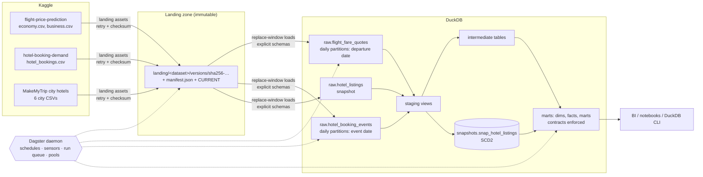

# Travel analytics: flights + stays on DuckDB, dbt and Dagster

[](https://github.com/rohit91jacob/travel-flights-stays-duckdb-dagster/actions/workflows/ci.yml)
[](LICENSE)
[](pyproject.toml)

An end-to-end, production-style data pipeline over three public Kaggle datasets: Indian
domestic **flight fares**, Portuguese **hotel booking demand**, and Indian **hotel listings**.
Dagster lands the files in an immutable, checksummed landing zone, loads them into DuckDB
as daily partitions that replay the static history as a day-by-day feed, and runs dbt to
build tested, contract-enforced marts: fare curves, route/airline comparisons, class
premiums, booking pace, cancellation drivers, ADR/LOS, revenue proxies and a cross-subject
trip-cost benchmark.

Everything runs on a laptop (no cloud account), and the same image runs under Docker
Compose with Postgres-backed Dagster.

## Contents

1. [Architecture](#architecture)
2. [Tech stack](#tech-stack)
3. [Data sources](#data-sources)
4. [Data model](#data-model)
5. [Quickstart](#quickstart)
6. [Configuration](#configuration)
7. [Testing and CI](#testing-and-ci)
8. [Operations](#operations)
9. [Project structure](#project-structure)
10. [Design decisions, limitations, roadmap](#design-decisions-and-trade-offs)
11. [License](#license)

## Architecture



| Component | Responsibility | Where |
| --- | --- | --- |
| Landing assets | Download each Kaggle dataset (skipped when the upstream version is unchanged), store it in a content-addressed, never-modified version directory with a sha256 manifest | `src/travel_pipeline/assets/landing.py`, `ingestion/manifest.py` |
| Raw assets | Validate headers against declared schemas, cast with strict types, and replace one window of daily partitions per run inside one DuckDB transaction | `assets/raw.py`, `ingestion/loaders.py`, `ingestion/schemas.py` |
| dbt project | Staging → intermediate → marts; seeds, an SCD2 snapshot, an incremental fact, 120+ tests, unit tests, contracts, source freshness | `dbt/` |
| Dagster definitions | Jobs, replay schedules, sensors (transform chaining, version reloads, Kaggle polling, failure alerts), asset checks, freshness policies, concurrency pools | `src/travel_pipeline/` |
| Deployment | One image; Compose runs Postgres, the gRPC code location (runs execute here), webserver and daemon | `Dockerfile`, `docker-compose.yml`, `docker/` |

## Tech stack

| Tool | Version | Role |
| --- | --- | --- |
| Python | 3.12 | runtime |
| [uv](https://docs.astral.sh/uv/) | 0.12.23 | dependency management (`uv.lock`) |
| Dagster | 1.13.25 (`dagster-dbt` 0.29.25, `dagster-postgres` 0.29.25) | orchestration |
| dbt-core | 1.12.5 with `dbt-duckdb` 1.11.0 | transformations, tests, docs |
| DuckDB | 1.5.6 | warehouse (single file) |
| pyarrow | 25.0.1 | CSV reading with stable row numbers |
| kaggle | 2.2.4 | downloads (new-style `KGAT_` tokens) |
| PostgreSQL | 17 (Compose only) | Dagster run/event storage |
| ruff 0.16.10, sqlfluff 4.4.0, pytest 9.1.1 | | quality gates |

## Data sources

| Dataset | Kaggle ref | Licence | Rows | What it is | Refresh |
| --- | --- | --- | --- | --- | --- |
| Flight fares | [`shubhambathwal/flight-price-prediction`](https://www.kaggle.com/datasets/shubhambathwal/flight-price-prediction) | CC0 1.0 | 300,261 (206,774 economy + 93,487 business) | EaseMyTrip fares for the 30 routes between 6 Indian metros, departures 2022-02-11 to 2022-03-31 | static upstream (v1); checked weekly |
| Hotel booking demand | [`jessemostipak/hotel-booking-demand`](https://www.kaggle.com/datasets/jessemostipak/hotel-booking-demand) | CC BY 4.0 | 119,390 bookings | Two Portuguese hotels (Algarve resort, Lisbon city), arrivals 2015-07-01 to 2017-08-31 | static upstream (v1); checked weekly |
| City hotel listings | [`andrewgeorgeissac/hotel-price-data-of-cities-in-india-makemytrip`](https://www.kaggle.com/datasets/andrewgeorgeissac/hotel-price-data-of-cities-in-india-makemytrip) | CDLA-Sharing 1.0 | 580 listings | MakeMyTrip listings for the same 6 metros as the flights (published 2023-08-19) | static upstream; checked weekly |

Attribution: Antonio, N., de Almeida, A. & Nunes, L. (2019), *Hotel booking demand datasets*,
Data in Brief 22, 41–49, [doi:10.1016/j.dib.2018.11.126](https://doi.org/10.1016/j.dib.2018.11.126);
Shubham Bathwal (Kaggle); Andrew George Issac (Kaggle). **No Kaggle data is committed.** CI and
the test suite use small synthetic files in `tests/fixtures/kaggle/` that mimic the real
schemas and quirks (generated by `scripts/generate_fixtures.py`).

Two facts about the data shape the design:

* **Every fare was observed on one day, 2022-02-10.** For every row, `days_left` =
  departure date − 2022-02-10, so the only time axis is the departure date. Flights are
  partitioned by departure date, and the fare curve is a cross-section of departures,
  not one flight getting dearer over time.
* **The two stays datasets do not share a geography.** The booking data is Portuguese. The
  listings cover the same six Indian cities as the flights, so only listings and flights
  are joined, through a conformed `dim_city`. Bookings stay a separate subject area that
  shares only `dim_date` and `dim_currency` (EUR vs INR, never converted).

## Data model

Full column-level documentation: **[docs/data_dictionary.md](docs/data_dictionary.md)**
(generated from the dbt YAML). Schemas in the DuckDB file: `raw`, `staging`,
`intermediate`, `snapshots`, `reference` (seeds), `marts`.

| Model | Grain | Key |
| --- | --- | --- |
| `dim_date`, `dim_currency`, `dim_city` | day / currency / metro (conformed) | `date_key`, `currency_code`, `city_name` |
| `dim_airline`, `dim_route` | carrier / directed route | `carrier_code`, `route_code` |
| `fct_flight_fare_quotes` (incremental) | one itinerary option × cabin class × departure date | `fare_quote_id` |
| `mart_flight_fare_curve` | route (or ALL) × class × days to departure | composite |
| `mart_flight_route_airline_fares`, `mart_flight_class_premium` | route × airline (× class) | composite |
| `mart_flight_stops_duration`, `mart_flight_departure_time` | class × stops × duration band / class × time band | composite |
| `dim_hotel`, `fct_hotel_bookings` | hotel / booking (status as of the replay date) | `hotel_code`, `booking_id` |
| `dim_hotel_booking_status_history` | booking status version (SCD2 from events) | `booking_status_version_id` |
| `mart_stays_booking_pace`, `_cancellation_drivers`, `_adr_los`, `_segment_channel_mix`, `_seasonality`, `_revenue_proxies` | see dictionary | composite |
| `dim_hotel_listing` (from snapshot), `mart_city_stay_prices` | listing / city × star band | `listing_id` |
| `mart_city_trip_cost_benchmark` | city | `city` |

## Quickstart

### Prerequisites

* [uv](https://docs.astral.sh/uv/getting-started/installation/) (it installs Python 3.12 for you), `make`, `git`
* For real data: a Kaggle API token in `KAGGLE_API_TOKEN` or `~/.kaggle/access_token`
* For Compose: Docker with Compose v2

### Run locally on the synthetic fixtures (no Kaggle account needed)

```bash
git clone https://github.com/rohit91jacob/travel-flights-stays-duckdb-dagster.git
cd travel-flights-stays-duckdb-dagster
make install
export TRAVEL_SOURCE_MODE=local TRAVEL_LOCAL_SOURCE_DIR=$PWD/tests/fixtures/kaggle DBT_TARGET=ci
make dbt-parse
make pipeline        # ingest -> load all flights partitions -> load all stays partitions -> transform
```

`make pipeline` ends with dbt's summary and a successful `transform_job` run:

```text
Done. PASS=159 WARN=0 ERROR=0 SKIP=0 NO-OP=0 REUSED=0 TOTAL=159
... transform_job - ... - RUN_SUCCESS - Finished execution of run for "transform_job".
```

### Run on the real Kaggle data

```bash
export KAGGLE_API_TOKEN=...            # or save it to ~/.kaggle/access_token
make dbt-parse
make pipeline                           # downloads ~55 MB from Kaggle on the first run
make dev                                # UI + daemon on http://localhost:3000
```

Query the marts with any DuckDB client while no run is active, for example:

```bash
uv run python -c "import duckdb; print(duckdb.connect('data/warehouse/travel.duckdb', read_only=True).sql(
  'select hotel_code, round(avg(is_canceled::int), 4) as cancellation_rate from marts.fct_hotel_bookings group by 1 order by 1'))"
```

```text
┌────────────┬───────────────────┐
│ hotel_code │ cancellation_rate │
├────────────┼───────────────────┤
│ H1         │            0.2776 │
│ H2         │            0.4173 │
└────────────┴───────────────────┘
```

Results from the real data, verified locally both with `make pipeline` and through
`dagster dev`, where the daemon's sensor triggered the transform:

| Check | Result |
| --- | --- |
| Fare quotes loaded / departure dates | 300,261 / 49 (2022-02-11 to 2022-03-31); 4 malformed durations flagged, not dropped |
| Mean fare, business / economy | ₹52,540.08 / ₹6,571.19 (Kaggle's `Clean_Dataset.csv`: ₹52,540.08 / ₹6,572.34; it drops 108 economy rows) |
| Bookings / cancelled | 119,390 / 44,224 = 37.04% (City Hotel 41.73%, Resort Hotel 27.76%) |
| Non-refundable deposits | 99.36% cancel |
| Asset checks evaluated | 343, all passed |
| Rerun of ingest + one flights day + one month of stays | all 27 warehouse tables byte-identical |

### Docker Compose (verified in CI only)

The Compose stack is exercised by the `docker` CI job; it has not been run on the
author's machine (no local Docker).

```bash
cp .env.example .env      # set DAGSTER_POSTGRES_PASSWORD and KAGGLE_API_TOKEN
make docker-build
make docker-up            # http://localhost:3000
make docker-down
```

## Configuration

All configuration is environment variables (see [`.env.example`](.env.example)).

| Variable | Default | Purpose |
| --- | --- | --- |
| `TRAVEL_SOURCE_MODE` | `kaggle` | `kaggle` downloads via the API; `local` copies from `TRAVEL_LOCAL_SOURCE_DIR/<dataset>/` |
| `TRAVEL_LOCAL_SOURCE_DIR` | – | Directory for `local` mode (CI uses `tests/fixtures/kaggle`) |
| `KAGGLE_API_TOKEN` | – | Kaggle token (alternatively `~/.kaggle/access_token`) |
| `TRAVEL_DATA_DIR` | `./data` | Root for the landing zone and warehouse |
| `TRAVEL_DUCKDB_PATH` | `$TRAVEL_DATA_DIR/warehouse/travel.duckdb` | DuckDB file shared by loaders, checks and dbt |
| `TRAVEL_DUCKDB_MEMORY_LIMIT` / `TRAVEL_DUCKDB_THREADS` | `2GB` / `4` | DuckDB resource limits |
| `DBT_TARGET` | `dev` | dbt target in `dbt/profiles.yml` (`dev`, `ci`, `prod`) |
| `TRAVEL_ENFORCE_SOURCE_FRESHNESS` | `true` | Fail the transform when raw data is older than dbt's `error_after` (50 h) |
| `TRAVEL_FLIGHTS_REPLAY_START`, `TRAVEL_STAYS_REPLAY_START` | – | Real date the replay clock starts (schedules skip while unset) |
| `TRAVEL_FLIGHTS_REPLAY_PARTITIONS_PER_DAY`, `TRAVEL_STAYS_REPLAY_PARTITIONS_PER_DAY` | `1`, `7` | Partitions released per daily tick |
| `ALERT_WEBHOOK_URL` | – | Slack-compatible webhook for failed runs (only logged when unset) |
| `DAGSTER_WEBSERVER_URL` | `http://localhost:3000` | Base URL used in alert links |
| `DAGSTER_POSTGRES_USER` / `_PASSWORD` / `_DB`, `DAGSTER_WEBSERVER_PORT` | `dagster` / required / `dagster`, `3000` | Compose only |

## Testing and CI

```bash
make lint        # ruff check, ruff format --check, sqlfluff (duckdb dialect)
make test        # 33 unit tests: manifests, schemas, loaders, replay clock, schedules, sensors, alerts, definitions
make test-e2e    # 4 end-to-end tests: every job in-process on fixtures, then reruns must leave every mart identical
make validate    # load the Dagster definitions as a deployment would
```

dbt itself carries 120+ data tests (generic, custom generic, singular, two warn-level drift
detectors), 5 unit tests, model contracts on every mart, and source freshness.

| CI job | What it proves |
| --- | --- |
| `lint` | ruff + sqlfluff are clean |
| `unit` | dbt manifest builds, Dagster definitions load, unit tests pass (coverage uploaded) |
| `pipeline` | `make pipeline` materialises every asset on fixtures through the Dagster CLI, a standalone `dbt build` passes on the same warehouse, the e2e/idempotency tests pass, dbt docs are uploaded as an artifact |
| `docker` | the image builds, definitions load inside it, the Compose stack comes up healthy, and `scripts/compose_smoke_test.py` launches the ingest and both full-range loads through the webserver, then waits for the **sensor** to trigger a successful dbt transform |

Dependabot keeps uv, GitHub Actions, Docker and Compose images current; `.pre-commit-config.yaml`
runs the same linters locally.

## Operations

* **Scheduling.** `flights_replay_schedule` and `stays_replay_schedule` (06:00 UTC, off by
  default) release the next partitions each day once a replay start date is set.
  `ingest_weekly_schedule` and `kaggle_upstream_version_sensor` (both off by default) pick up
  new upstream versions.
* **Chaining.** `transform_on_raw_update` runs dbt once all raw sources exist and any of them
  changed. It waits for in-progress loads, so a burst of loads produces one transform.
  `reload_on_new_dataset_version` reloads every already-loaded partition after a new upstream version lands.
* **Backfill and reprocessing.** Raw assets use single-run backfill policies: a range of
  any size is one run and one DuckDB transaction. Re-running a window replaces exactly
  that window, and `fct_flight_fare_quotes` rebuilds only the reloaded departure dates.
* **Concurrency.** DuckDB is single-writer. Every warehouse step claims the `duckdb` pool
  (limit 1) and every job carries a tag limited to one concurrent run, so runs queue instead of failing on locks.
* **Data quality.** Blocking asset checks (landing checksums, landing↔raw reconciliation
  per partition, booking-event consistency, listing uniqueness), dbt tests as asset checks,
  freshness policies (warn 26 h, fail 50 h) on raw assets and marts, dbt source freshness,
  and run retries for crashed workers.
* **Alerting.** `alert_on_run_failure` posts every failed run, including failed blocking checks, to `ALERT_WEBHOOK_URL`.

Procedures for backfills, new upstream versions, rollbacks and failure triage are in the
**[runbook](docs/runbook.md)**.

## Project structure

```text
├── src/travel_pipeline/
│   ├── definitions.py        # Dagster code location
│   ├── assets/               # landing.py, raw.py (+ asset checks), dbt.py
│   ├── ingestion/            # manifest.py, sources.py, schemas.py, readers.py, loaders.py
│   ├── jobs.py  schedules.py  sensors.py  replay.py
│   ├── partitions.py  policies.py  resources.py  settings.py  datasets.py
├── dbt/
│   ├── models/{staging,intermediate,marts/{core,flights,stays,listings,cross}}/
│   ├── snapshots/  seeds/  macros/  tests/
│   └── dbt_project.yml  profiles.yml
├── tests/                    # pytest suite + synthetic Kaggle-shaped fixtures
├── scripts/                  # fixture + data-dictionary generators, Compose smoke test
├── docker/                   # dagster.yaml (Postgres), workspace.yaml
├── dagster_home/dagster.yaml # local instance config (same concurrency rules)
├── docs/                     # data_dictionary.md, runbook.md
├── Dockerfile  docker-compose.yml  docker-compose.ci.yml
├── Makefile  pyproject.toml  uv.lock  .env.example
└── .github/                  # CI workflow, Dependabot
```

## Design decisions and trade-offs

* **Event-sourced stays partitions.** Each booking becomes a `booking_created` event
  (arrival − lead time) and a `status_changed` event (reservation status date). Replaying
  day by day only reveals what was known that day: a booking is `Booked` with an unknown
  outcome until its status event arrives. The SCD2 status history is derived from these
  events, not from a dbt snapshot, so it stays exact under backfills and out-of-order
  reruns.
* **dbt snapshot only where attributes really change.** Listing prices, ratings and review
  counts change between captures, so `snap_hotel_listings` (check strategy, hard deletes
  invalidated) records them across upstream versions.
* **Content-addressed landing.** Version directories are named by the hash of their files,
  so re-landing is a no-op, history is reproducible, and rollback means rewriting one pointer file.
* **Row-number identity.** Neither source has a natural key and both contain exact
  duplicate rows, which are kept as separate rows. Ids derive from the source file and row
  number, so they are stable within an upstream version.
* **Full rebuilds for small marts, incremental for the big fact.** At this scale, DuckDB
  rebuilds the marts in seconds; only `fct_flight_fare_quotes` uses incremental delete+insert.
* **Single DuckDB file.** It is simple and fast, but it means one writer at a time (handled
  by pools and run tags) and no concurrent BI reads during runs.

### Known limitations

* The upstream datasets are static snapshots; the "daily feed" is a replay.
* Fare curves mix lead time with departure-date seasonality, because there is a single observation date.
* RevPAR and occupancy are proxies (capacity assumed = peak observed occupied rooms). The
  source publishes no room inventory, so true RevPAR is not computed.
* The trip-cost benchmark combines fares observed on 2022-02-10 with listing prices
  published on 2023-08-19 (555 days apart); use it to compare cities, not as a price.
* `booking_id` is a source row number. If an upstream version reorders rows, all bookings
  are reloaded with new ids (handled by the version-reload sensor, but ids are not stable across versions).
* The Compose deployment has been verified in CI, not on a workstation.

### Roadmap

* Publish marts to a read replica (Parquet export or MotherDuck) so BI reads never contend with writes.
* Add FX conversion (ECB reference rates) to compare EUR and INR measures.
* Freshness-failure alerts (today, only run failures alert) and a lightweight dashboard.

## License

Code: [MIT](LICENSE). Data: not redistributed; each dataset keeps its own licence (see
[Data sources](#data-sources)).
